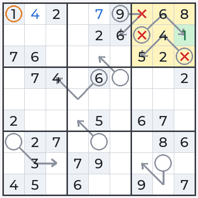

<!-- Written by tools/walkthrough.py arrow: edit the script, not this page. -->
# Arrow, step 3: the 1 in box 3

**Step 3 of 49** · [← Step 2](step-02.md) · [All steps](../arrow.md#the-whole-puzzle-step-by-step) · [Step 4 →](step-04.md)

Box 3 needs a 1. r1c7: row 1 has one (r1c1). r2c7: it's an arrow's circle, and its shaft makes at least 7. r3c9: it's an arrow's circle, and its shaft adds up to 9. Only **r2c9** is left: **r2c9 = 1**.

**Step 3 of 49** · [← Step 2](step-02.md) · [All steps](../arrow.md#the-whole-puzzle-step-by-step) · [Step 4 →](step-04.md)
