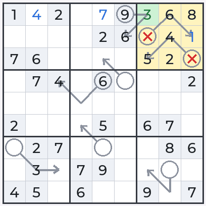

<!-- Written by tools/walkthrough.py arrow: edit the script, not this page. -->
# Arrow, step 4: the 3 in box 3

**Step 4 of 49** · [← Step 3](step-03.md) · [All steps](../arrow.md#the-whole-puzzle-step-by-step) · [Step 5 →](step-05.md)

Box 3 needs a 3. r2c7: it's an arrow's circle, and its shaft adds up to 7. r3c9: it's an arrow's circle, and its shaft adds up to 9. Only **r1c7** is left: **r1c7 = 3**.

**Step 4 of 49** · [← Step 3](step-03.md) · [All steps](../arrow.md#the-whole-puzzle-step-by-step) · [Step 5 →](step-05.md)
