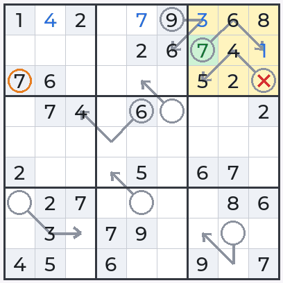

<!-- Written by tools/walkthrough.py arrow: edit the script, not this page. -->
# Arrow, step 5: the 7 in box 3

**Step 5 of 49** · [← Step 4](step-04.md) · [All steps](../arrow.md#the-whole-puzzle-step-by-step) · [Step 6 →](step-06.md)

Box 3 needs a 7. r3c9: row 3 has one (r3c1). Only **r2c7** is left: **r2c7 = 7**.

**Step 5 of 49** · [← Step 4](step-04.md) · [All steps](../arrow.md#the-whole-puzzle-step-by-step) · [Step 6 →](step-06.md)
