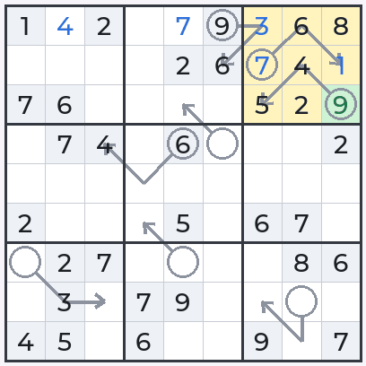

<!-- Written by tools/walkthrough.py arrow: edit the script, not this page. -->
# Arrow, step 6: the 9 in box 3

**Step 6 of 49** · [← Step 5](step-05.md) · [All steps](../arrow.md#the-whole-puzzle-step-by-step) · [Step 7 →](step-07.md)

Box 3 needs a 9, and r3c9 is its last empty cell: **r3c9 = 9**.

**Step 6 of 49** · [← Step 5](step-05.md) · [All steps](../arrow.md#the-whole-puzzle-step-by-step) · [Step 7 →](step-07.md)
