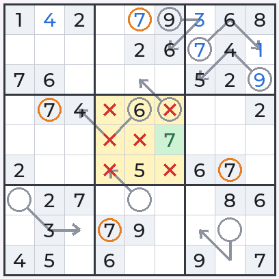

<!-- Written by tools/walkthrough.py arrow: edit the script, not this page. -->
# Arrow, step 7: the 7 in box 5

**Step 7 of 49** · [← Step 6](step-06.md) · [All steps](../arrow.md#the-whole-puzzle-step-by-step) · [Step 8 →](step-08.md)

Box 5 needs a 7. r4c4 and r4c6: row 4 has one (r4c2). r5c4: column 4 has one (r8c4). r5c5: column 5 has one (r1c5). r6c4 and r6c6: row 6 has one (r6c8). Only **r5c6** is left: **r5c6 = 7**.

**Step 7 of 49** · [← Step 6](step-06.md) · [All steps](../arrow.md#the-whole-puzzle-step-by-step) · [Step 8 →](step-08.md)
