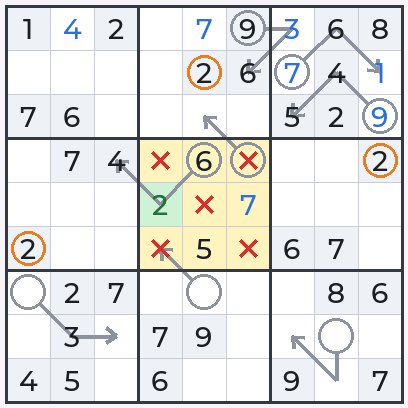

<!-- Written by tools/walkthrough.py arrow: edit the script, not this page. -->
# Arrow, step 8: the 2 in box 5

**Step 8 of 49** · [← Step 7](step-07.md) · [All steps](../arrow.md#the-whole-puzzle-step-by-step) · [Step 9 →](step-09.md)

Box 5 needs a 2. r4c4 and r4c6: row 4 has one (r4c9). r5c5: column 5 has one (r2c5). r6c4 and r6c6: row 6 has one (r6c1). Only **r5c4** is left: **r5c4 = 2**.

**Step 8 of 49** · [← Step 7](step-07.md) · [All steps](../arrow.md#the-whole-puzzle-step-by-step) · [Step 9 →](step-09.md)
