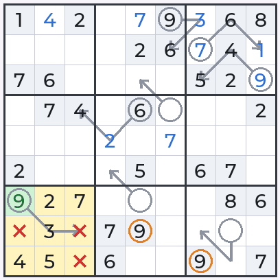

<!-- Written by tools/walkthrough.py arrow: edit the script, not this page. -->
# Arrow, step 9: the 9 in box 7

**Step 9 of 49** · [← Step 8](step-08.md) · [All steps](../arrow.md#the-whole-puzzle-step-by-step) · [Step 10 →](step-10.md)

Box 7 needs a 9. r8c1 and r8c3: row 8 has one (r8c5). r9c3: row 9 has one (r9c7). Only **r7c1** is left: **r7c1 = 9**.

**Step 9 of 49** · [← Step 8](step-08.md) · [All steps](../arrow.md#the-whole-puzzle-step-by-step) · [Step 10 →](step-10.md)
