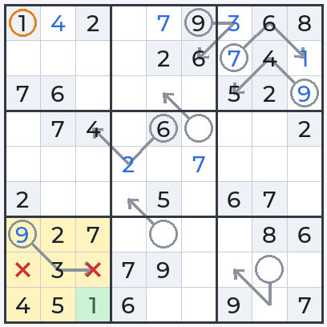

<!-- Written by tools/walkthrough.py arrow: edit the script, not this page. -->
# Arrow, step 10: the 1 in box 7

**Step 10 of 49** · [← Step 9](step-09.md) · [All steps](../arrow.md#the-whole-puzzle-step-by-step) · [Step 11 →](step-11.md)

Box 7 needs a 1. r8c1: column 1 has one (r1c1). r8c3: it's on the shaft of the arrow whose circle is 9 (in r7c1): a 1 would take the shaft to 4. Only **r9c3** is left: **r9c3 = 1**.

**Step 10 of 49** · [← Step 9](step-09.md) · [All steps](../arrow.md#the-whole-puzzle-step-by-step) · [Step 11 →](step-11.md)
