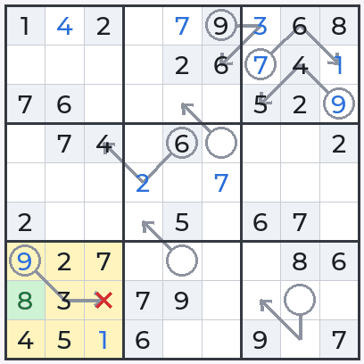

<!-- Written by tools/walkthrough.py arrow: edit the script, not this page. -->
# Arrow, step 11: the 8 in box 7

**Step 11 of 49** · [← Step 10](step-10.md) · [All steps](../arrow.md#the-whole-puzzle-step-by-step) · [Step 12 →](step-12.md)

Box 7 needs an 8. r8c3: it's on the shaft of the arrow whose circle is 9 (in r7c1): an 8 would take the shaft to 11. Only **r8c1** is left: **r8c1 = 8**.

**Step 11 of 49** · [← Step 10](step-10.md) · [All steps](../arrow.md#the-whole-puzzle-step-by-step) · [Step 12 →](step-12.md)
