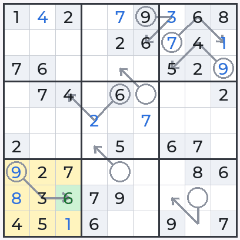

<!-- Written by tools/walkthrough.py arrow: edit the script, not this page. -->
# Arrow, step 12: the 6 in box 7

**Step 12 of 49** · [← Step 11](step-11.md) · [All steps](../arrow.md#the-whole-puzzle-step-by-step) · [Step 13 →](step-13.md)

Box 7 needs a 6, and r8c3 is its last empty cell: **r8c3 = 6**.

**Step 12 of 49** · [← Step 11](step-11.md) · [All steps](../arrow.md#the-whole-puzzle-step-by-step) · [Step 13 →](step-13.md)
