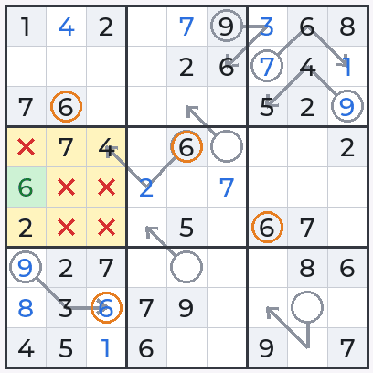

<!-- Written by tools/walkthrough.py arrow: edit the script, not this page. -->
# Arrow, step 13: the 6 in box 4

**Step 13 of 49** · [← Step 12](step-12.md) · [All steps](../arrow.md#the-whole-puzzle-step-by-step) · [Step 14 →](step-14.md)

Box 4 needs a 6. r4c1: row 4 has one (r4c5). r5c2: column 2 has one (r3c2). r5c3: column 3 has one (r8c3). r6c2 and r6c3: row 6 has one (r6c7). Only **r5c1** is left: **r5c1 = 6**.

**Step 13 of 49** · [← Step 12](step-12.md) · [All steps](../arrow.md#the-whole-puzzle-step-by-step) · [Step 14 →](step-14.md)
