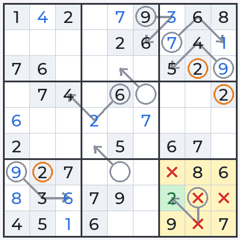

<!-- Written by tools/walkthrough.py arrow: edit the script, not this page. -->
# Arrow, step 14: the 2 in box 9

**Step 14 of 49** · [← Step 13](step-13.md) · [All steps](../arrow.md#the-whole-puzzle-step-by-step) · [Step 15 →](step-15.md)

Box 9 needs a 2. r7c7: row 7 has one (r7c2). r8c8 and r9c8: column 8 has one (r3c8). r8c9: column 9 has one (r4c9). Only **r8c7** is left: **r8c7 = 2**.

**Step 14 of 49** · [← Step 13](step-13.md) · [All steps](../arrow.md#the-whole-puzzle-step-by-step) · [Step 15 →](step-15.md)
