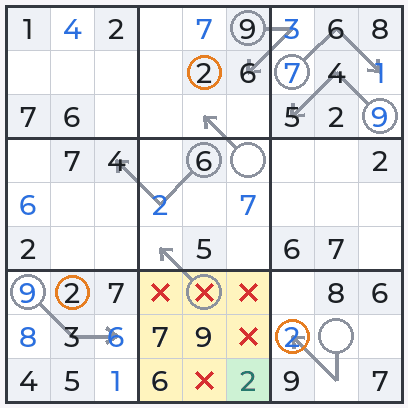

<!-- Written by tools/walkthrough.py arrow: edit the script, not this page. -->
# Arrow, step 15: the 2 in box 8

**Step 15 of 49** · [← Step 14](step-14.md) · [All steps](../arrow.md#the-whole-puzzle-step-by-step) · [Step 16 →](step-16.md)

Box 8 needs a 2. r7c4, r7c5 and r7c6: row 7 has one (r7c2). r8c6: row 8 has one (r8c7). r9c5: column 5 has one (r2c5). Only **r9c6** is left: **r9c6 = 2**.

**Step 15 of 49** · [← Step 14](step-14.md) · [All steps](../arrow.md#the-whole-puzzle-step-by-step) · [Step 16 →](step-16.md)
