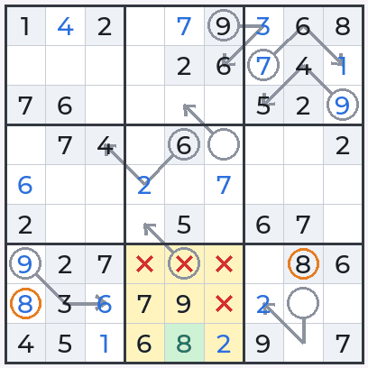

<!-- Written by tools/walkthrough.py arrow: edit the script, not this page. -->
# Arrow, step 16: the 8 in box 8

**Step 16 of 49** · [← Step 15](step-15.md) · [All steps](../arrow.md#the-whole-puzzle-step-by-step) · [Step 17 →](step-17.md)

Box 8 needs an 8. r7c4, r7c5 and r7c6: row 7 has one (r7c8). r8c6: row 8 has one (r8c1). Only **r9c5** is left: **r9c5 = 8**.

**Step 16 of 49** · [← Step 15](step-15.md) · [All steps](../arrow.md#the-whole-puzzle-step-by-step) · [Step 17 →](step-17.md)
