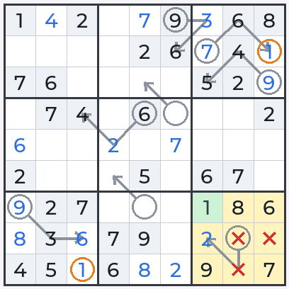

<!-- Written by tools/walkthrough.py arrow: edit the script, not this page. -->
# Arrow, step 17: the 1 in box 9

**Step 17 of 49** · [← Step 16](step-16.md) · [All steps](../arrow.md#the-whole-puzzle-step-by-step) · [Step 18 →](step-18.md)

Box 9 needs a 1. r8c9: column 9 has one (r2c9). r9c8: row 9 has one (r9c3). r8c8: it's an arrow's circle, and its shaft makes at least 3. Only **r7c7** is left: **r7c7 = 1**.

**Step 17 of 49** · [← Step 16](step-16.md) · [All steps](../arrow.md#the-whole-puzzle-step-by-step) · [Step 18 →](step-18.md)
