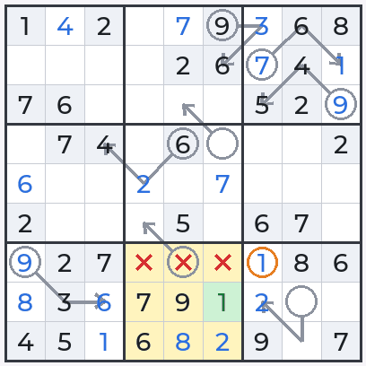

<!-- Written by tools/walkthrough.py arrow: edit the script, not this page. -->
# Arrow, step 18: the 1 in box 8

**Step 18 of 49** · [← Step 17](step-17.md) · [All steps](../arrow.md#the-whole-puzzle-step-by-step) · [Step 19 →](step-19.md)

Box 8 needs a 1. r7c4, r7c5 and r7c6: row 7 has one (r7c7). Only **r8c6** is left: **r8c6 = 1**.

**Step 18 of 49** · [← Step 17](step-17.md) · [All steps](../arrow.md#the-whole-puzzle-step-by-step) · [Step 19 →](step-19.md)
