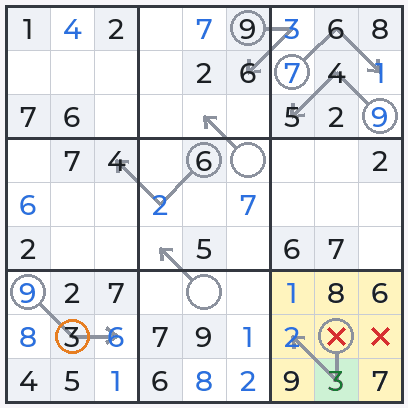

<!-- Written by tools/walkthrough.py arrow: edit the script, not this page. -->
# Arrow, step 19: the 3 in box 9

**Step 19 of 49** · [← Step 18](step-18.md) · [All steps](../arrow.md#the-whole-puzzle-step-by-step) · [Step 20 →](step-20.md)

Box 9 needs a 3. r8c8 and r8c9: row 8 has one (r8c2). Only **r9c8** is left: **r9c8 = 3**.

**Step 19 of 49** · [← Step 18](step-18.md) · [All steps](../arrow.md#the-whole-puzzle-step-by-step) · [Step 20 →](step-20.md)
