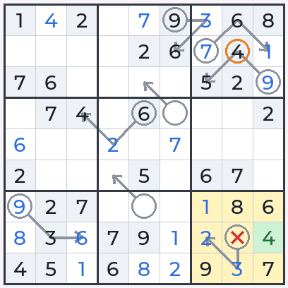

<!-- Written by tools/walkthrough.py arrow: edit the script, not this page. -->
# Arrow, step 20: the 4 in box 9

**Step 20 of 49** · [← Step 19](step-19.md) · [All steps](../arrow.md#the-whole-puzzle-step-by-step) · [Step 21 →](step-21.md)

Box 9 needs a 4. r8c8: column 8 has one (r2c8). Only **r8c9** is left: **r8c9 = 4**.

**Step 20 of 49** · [← Step 19](step-19.md) · [All steps](../arrow.md#the-whole-puzzle-step-by-step) · [Step 21 →](step-21.md)
