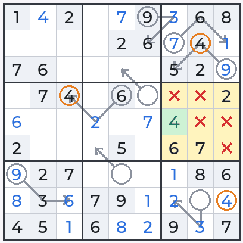

<!-- Written by tools/walkthrough.py arrow: edit the script, not this page. -->
# Arrow, step 21: the 4 in box 6

**Step 21 of 49** · [← Step 20](step-20.md) · [All steps](../arrow.md#the-whole-puzzle-step-by-step) · [Step 22 →](step-22.md)

Box 6 needs a 4. r4c7 and r4c8: row 4 has one (r4c3). r5c8: column 8 has one (r2c8). r5c9 and r6c9: column 9 has one (r8c9). Only **r5c7** is left: **r5c7 = 4**.

**Step 21 of 49** · [← Step 20](step-20.md) · [All steps](../arrow.md#the-whole-puzzle-step-by-step) · [Step 22 →](step-22.md)
