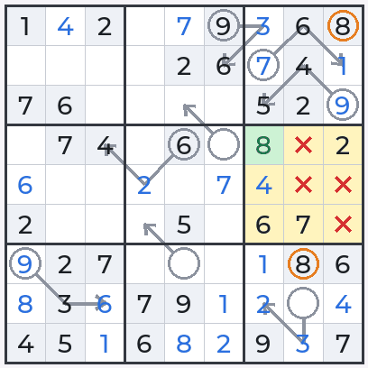

<!-- Written by tools/walkthrough.py arrow: edit the script, not this page. -->
# Arrow, step 22: the 8 in box 6

**Step 22 of 49** · [← Step 21](step-21.md) · [All steps](../arrow.md#the-whole-puzzle-step-by-step) · [Step 23 →](step-23.md)

Box 6 needs an 8. r4c8 and r5c8: column 8 has one (r7c8). r5c9 and r6c9: column 9 has one (r1c9). Only **r4c7** is left: **r4c7 = 8**.

**Step 22 of 49** · [← Step 21](step-21.md) · [All steps](../arrow.md#the-whole-puzzle-step-by-step) · [Step 23 →](step-23.md)
