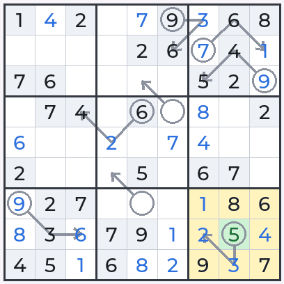

<!-- Written by tools/walkthrough.py arrow: edit the script, not this page. -->
# Arrow, step 23: the 5 in box 9

**Step 23 of 49** · [← Step 22](step-22.md) · [All steps](../arrow.md#the-whole-puzzle-step-by-step) · [Step 24 →](step-24.md)

Box 9 needs a 5, and r8c8 is its last empty cell: **r8c8 = 5**.

**Step 23 of 49** · [← Step 22](step-22.md) · [All steps](../arrow.md#the-whole-puzzle-step-by-step) · [Step 24 →](step-24.md)
