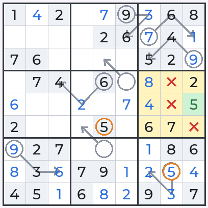

<!-- Written by tools/walkthrough.py arrow: edit the script, not this page. -->
# Arrow, step 24: the 5 in box 6

**Step 24 of 49** · [← Step 23](step-23.md) · [All steps](../arrow.md#the-whole-puzzle-step-by-step) · [Step 25 →](step-25.md)

Box 6 needs a 5. r4c8 and r5c8: column 8 has one (r8c8). r6c9: row 6 has one (r6c5). Only **r5c9** is left: **r5c9 = 5**.

**Step 24 of 49** · [← Step 23](step-23.md) · [All steps](../arrow.md#the-whole-puzzle-step-by-step) · [Step 25 →](step-25.md)
