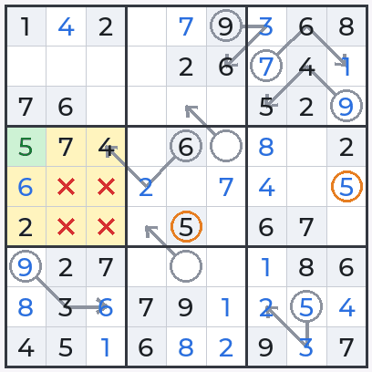

<!-- Written by tools/walkthrough.py arrow: edit the script, not this page. -->
# Arrow, step 25: the 5 in box 4

**Step 25 of 49** · [← Step 24](step-24.md) · [All steps](../arrow.md#the-whole-puzzle-step-by-step) · [Step 26 →](step-26.md)

Box 4 needs a 5. r5c2 and r5c3: row 5 has one (r5c9). r6c2 and r6c3: row 6 has one (r6c5). Only **r4c1** is left: **r4c1 = 5**.

**Step 25 of 49** · [← Step 24](step-24.md) · [All steps](../arrow.md#the-whole-puzzle-step-by-step) · [Step 26 →](step-26.md)
