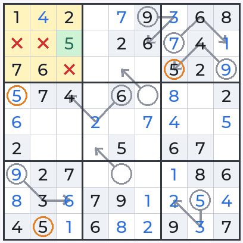

<!-- Written by tools/walkthrough.py arrow: edit the script, not this page. -->
# Arrow, step 26: the 5 in box 1

**Step 26 of 49** · [← Step 25](step-25.md) · [All steps](../arrow.md#the-whole-puzzle-step-by-step) · [Step 27 →](step-27.md)

Box 1 needs a 5. r2c1: column 1 has one (r4c1). r2c2: column 2 has one (r9c2). r3c3: row 3 has one (r3c7). Only **r2c3** is left: **r2c3 = 5**.

**Step 26 of 49** · [← Step 25](step-25.md) · [All steps](../arrow.md#the-whole-puzzle-step-by-step) · [Step 27 →](step-27.md)
