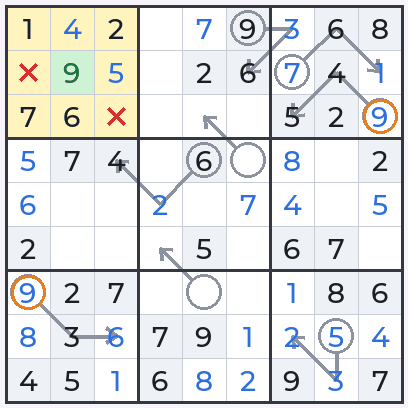

<!-- Written by tools/walkthrough.py arrow: edit the script, not this page. -->
# Arrow, step 27: the 9 in box 1

**Step 27 of 49** · [← Step 26](step-26.md) · [All steps](../arrow.md#the-whole-puzzle-step-by-step) · [Step 28 →](step-28.md)

Box 1 needs a 9. r2c1: column 1 has one (r7c1). r3c3: row 3 has one (r3c9). Only **r2c2** is left: **r2c2 = 9**.

**Step 27 of 49** · [← Step 26](step-26.md) · [All steps](../arrow.md#the-whole-puzzle-step-by-step) · [Step 28 →](step-28.md)
