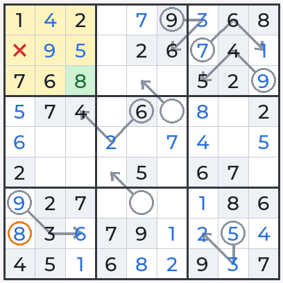

<!-- Written by tools/walkthrough.py arrow: edit the script, not this page. -->
# Arrow, step 28: the 8 in box 1

**Step 28 of 49** · [← Step 27](step-27.md) · [All steps](../arrow.md#the-whole-puzzle-step-by-step) · [Step 29 →](step-29.md)

Box 1 needs an 8. r2c1: column 1 has one (r8c1). Only **r3c3** is left: **r3c3 = 8**.

**Step 28 of 49** · [← Step 27](step-27.md) · [All steps](../arrow.md#the-whole-puzzle-step-by-step) · [Step 29 →](step-29.md)
