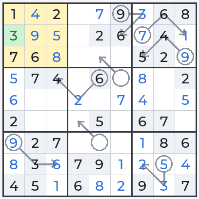

<!-- Written by tools/walkthrough.py arrow: edit the script, not this page. -->
# Arrow, step 29: the 3 in box 1

**Step 29 of 49** · [← Step 28](step-28.md) · [All steps](../arrow.md#the-whole-puzzle-step-by-step) · [Step 30 →](step-30.md)

Box 1 needs a 3, and r2c1 is its last empty cell: **r2c1 = 3**.

**Step 29 of 49** · [← Step 28](step-28.md) · [All steps](../arrow.md#the-whole-puzzle-step-by-step) · [Step 30 →](step-30.md)
