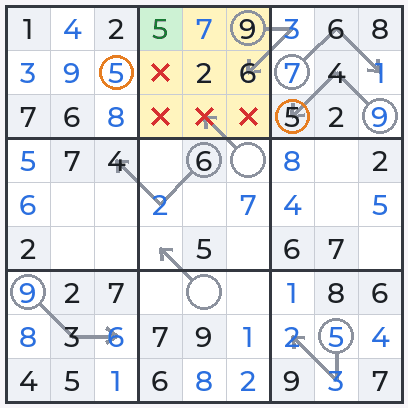

<!-- Written by tools/walkthrough.py arrow: edit the script, not this page. -->
# Arrow, step 30: the 5 in box 2

**Step 30 of 49** · [← Step 29](step-29.md) · [All steps](../arrow.md#the-whole-puzzle-step-by-step) · [Step 31 →](step-31.md)

Box 2 needs a 5. r2c4: row 2 has one (r2c3). r3c4, r3c5 and r3c6: row 3 has one (r3c7). Only **r1c4** is left: **r1c4 = 5**.

**Step 30 of 49** · [← Step 29](step-29.md) · [All steps](../arrow.md#the-whole-puzzle-step-by-step) · [Step 31 →](step-31.md)
