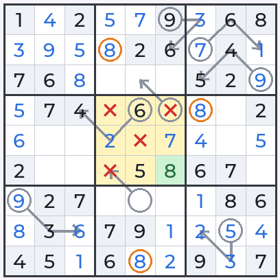

<!-- Written by tools/walkthrough.py arrow: edit the script, not this page. -->
# Arrow, step 32: the 8 in box 5

**Step 32 of 49** · [← Step 31](step-31.md) · [All steps](../arrow.md#the-whole-puzzle-step-by-step) · [Step 33 →](step-33.md)

Box 5 needs an 8. r4c4 and r4c6: row 4 has one (r4c7). r5c5: column 5 has one (r9c5). r6c4: column 4 has one (r2c4). Only **r6c6** is left: **r6c6 = 8**.

**Step 32 of 49** · [← Step 31](step-31.md) · [All steps](../arrow.md#the-whole-puzzle-step-by-step) · [Step 33 →](step-33.md)
