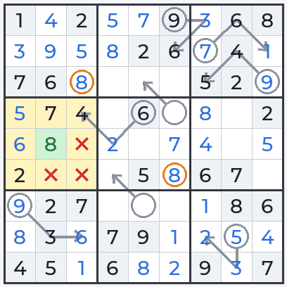

<!-- Written by tools/walkthrough.py arrow: edit the script, not this page. -->
# Arrow, step 33: the 8 in box 4

**Step 33 of 49** · [← Step 32](step-32.md) · [All steps](../arrow.md#the-whole-puzzle-step-by-step) · [Step 34 →](step-34.md)

Box 4 needs an 8. r5c3: column 3 has one (r3c3). r6c2 and r6c3: row 6 has one (r6c6). Only **r5c2** is left: **r5c2 = 8**.

**Step 33 of 49** · [← Step 32](step-32.md) · [All steps](../arrow.md#the-whole-puzzle-step-by-step) · [Step 34 →](step-34.md)
