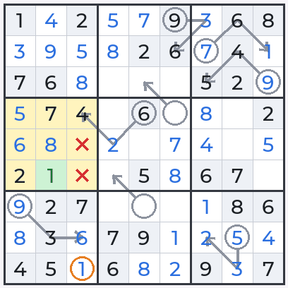

<!-- Written by tools/walkthrough.py arrow: edit the script, not this page. -->
# Arrow, step 34: the 1 in box 4

**Step 34 of 49** · [← Step 33](step-33.md) · [All steps](../arrow.md#the-whole-puzzle-step-by-step) · [Step 35 →](step-35.md)

Box 4 needs a 1. r5c3 and r6c3: column 3 has one (r9c3). Only **r6c2** is left: **r6c2 = 1**.

**Step 34 of 49** · [← Step 33](step-33.md) · [All steps](../arrow.md#the-whole-puzzle-step-by-step) · [Step 35 →](step-35.md)
