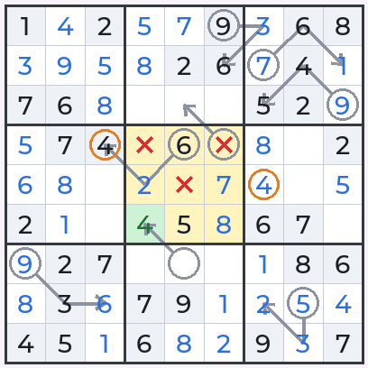

<!-- Written by tools/walkthrough.py arrow: edit the script, not this page. -->
# Arrow, step 35: the 4 in box 5

**Step 35 of 49** · [← Step 34](step-34.md) · [All steps](../arrow.md#the-whole-puzzle-step-by-step) · [Step 36 →](step-36.md)

Box 5 needs a 4. r4c4 and r4c6: row 4 has one (r4c3). r5c5: row 5 has one (r5c7). Only **r6c4** is left: **r6c4 = 4**.

**Step 35 of 49** · [← Step 34](step-34.md) · [All steps](../arrow.md#the-whole-puzzle-step-by-step) · [Step 36 →](step-36.md)
