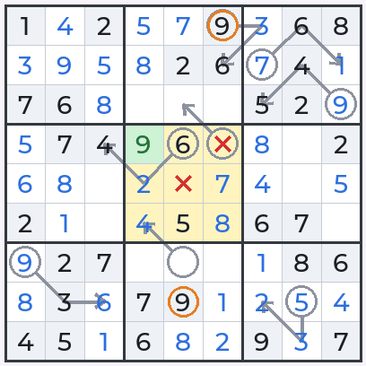

<!-- Written by tools/walkthrough.py arrow: edit the script, not this page. -->
# Arrow, step 36: the 9 in box 5

**Step 36 of 49** · [← Step 35](step-35.md) · [All steps](../arrow.md#the-whole-puzzle-step-by-step) · [Step 37 →](step-37.md)

Box 5 needs a 9. r4c6: column 6 has one (r1c6). r5c5: column 5 has one (r8c5). Only **r4c4** is left: **r4c4 = 9**.

**Step 36 of 49** · [← Step 35](step-35.md) · [All steps](../arrow.md#the-whole-puzzle-step-by-step) · [Step 37 →](step-37.md)
