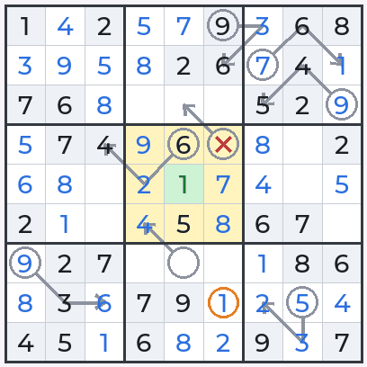

<!-- Written by tools/walkthrough.py arrow: edit the script, not this page. -->
# Arrow, step 37: the 1 in box 5

**Step 37 of 49** · [← Step 36](step-36.md) · [All steps](../arrow.md#the-whole-puzzle-step-by-step) · [Step 38 →](step-38.md)

Box 5 needs a 1. r4c6: column 6 has one (r8c6). Only **r5c5** is left: **r5c5 = 1**.

**Step 37 of 49** · [← Step 36](step-36.md) · [All steps](../arrow.md#the-whole-puzzle-step-by-step) · [Step 38 →](step-38.md)
