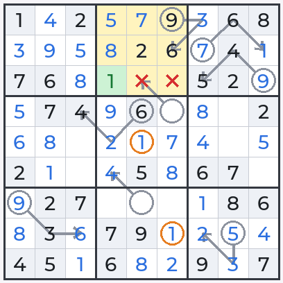

<!-- Written by tools/walkthrough.py arrow: edit the script, not this page. -->
# Arrow, step 38: the 1 in box 2

**Step 38 of 49** · [← Step 37](step-37.md) · [All steps](../arrow.md#the-whole-puzzle-step-by-step) · [Step 39 →](step-39.md)

Box 2 needs a 1. r3c5: column 5 has one (r5c5). r3c6: column 6 has one (r8c6). Only **r3c4** is left: **r3c4 = 1**.

**Step 38 of 49** · [← Step 37](step-37.md) · [All steps](../arrow.md#the-whole-puzzle-step-by-step) · [Step 39 →](step-39.md)
