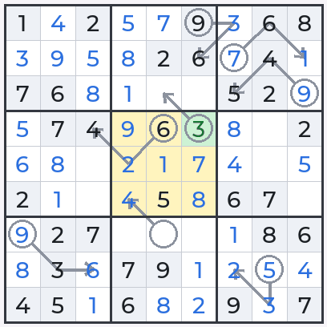

<!-- Written by tools/walkthrough.py arrow: edit the script, not this page. -->
# Arrow, step 39: the 3 in box 5

**Step 39 of 49** · [← Step 38](step-38.md) · [All steps](../arrow.md#the-whole-puzzle-step-by-step) · [Step 40 →](step-40.md)

Box 5 needs a 3, and r4c6 is its last empty cell: **r4c6 = 3**.

**Step 39 of 49** · [← Step 38](step-38.md) · [All steps](../arrow.md#the-whole-puzzle-step-by-step) · [Step 40 →](step-40.md)
