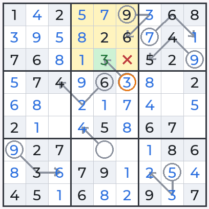

<!-- Written by tools/walkthrough.py arrow: edit the script, not this page. -->
# Arrow, step 40: the 3 in box 2

**Step 40 of 49** · [← Step 39](step-39.md) · [All steps](../arrow.md#the-whole-puzzle-step-by-step) · [Step 41 →](step-41.md)

Box 2 needs a 3. r3c6: column 6 has one (r4c6). Only **r3c5** is left: **r3c5 = 3**.

**Step 40 of 49** · [← Step 39](step-39.md) · [All steps](../arrow.md#the-whole-puzzle-step-by-step) · [Step 41 →](step-41.md)
