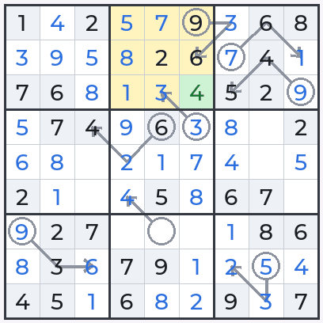

<!-- Written by tools/walkthrough.py arrow: edit the script, not this page. -->
# Arrow, step 41: the 4 in box 2

**Step 41 of 49** · [← Step 40](step-40.md) · [All steps](../arrow.md#the-whole-puzzle-step-by-step) · [Step 42 →](step-42.md)

Box 2 needs a 4, and r3c6 is its last empty cell: **r3c6 = 4**.

**Step 41 of 49** · [← Step 40](step-40.md) · [All steps](../arrow.md#the-whole-puzzle-step-by-step) · [Step 42 →](step-42.md)
