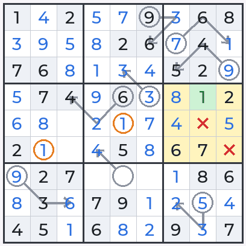

<!-- Written by tools/walkthrough.py arrow: edit the script, not this page. -->
# Arrow, step 42: the 1 in box 6

**Step 42 of 49** · [← Step 41](step-41.md) · [All steps](../arrow.md#the-whole-puzzle-step-by-step) · [Step 43 →](step-43.md)

Box 6 needs a 1. r5c8: row 5 has one (r5c5). r6c9: row 6 has one (r6c2). Only **r4c8** is left: **r4c8 = 1**.

**Step 42 of 49** · [← Step 41](step-41.md) · [All steps](../arrow.md#the-whole-puzzle-step-by-step) · [Step 43 →](step-43.md)
