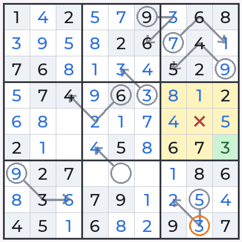

<!-- Written by tools/walkthrough.py arrow: edit the script, not this page. -->
# Arrow, step 43: the 3 in box 6

**Step 43 of 49** · [← Step 42](step-42.md) · [All steps](../arrow.md#the-whole-puzzle-step-by-step) · [Step 44 →](step-44.md)

Box 6 needs a 3. r5c8: column 8 has one (r9c8). Only **r6c9** is left: **r6c9 = 3**.

**Step 43 of 49** · [← Step 42](step-42.md) · [All steps](../arrow.md#the-whole-puzzle-step-by-step) · [Step 44 →](step-44.md)
