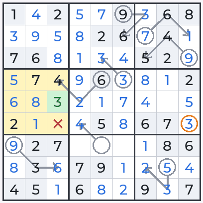

<!-- Written by tools/walkthrough.py arrow: edit the script, not this page. -->
# Arrow, step 44: the 3 in box 4

**Step 44 of 49** · [← Step 43](step-43.md) · [All steps](../arrow.md#the-whole-puzzle-step-by-step) · [Step 45 →](step-45.md)

Box 4 needs a 3. r6c3: row 6 has one (r6c9). Only **r5c3** is left: **r5c3 = 3**.

**Step 44 of 49** · [← Step 43](step-43.md) · [All steps](../arrow.md#the-whole-puzzle-step-by-step) · [Step 45 →](step-45.md)
