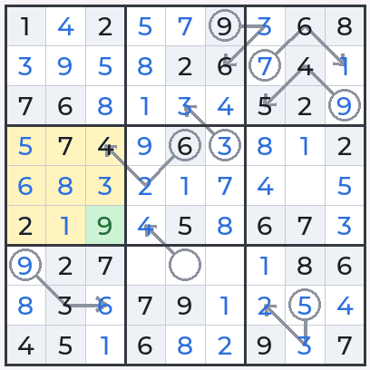

<!-- Written by tools/walkthrough.py arrow: edit the script, not this page. -->
# Arrow, step 45: the 9 in box 4

**Step 45 of 49** · [← Step 44](step-44.md) · [All steps](../arrow.md#the-whole-puzzle-step-by-step) · [Step 46 →](step-46.md)

Box 4 needs a 9, and r6c3 is its last empty cell: **r6c3 = 9**.

**Step 45 of 49** · [← Step 44](step-44.md) · [All steps](../arrow.md#the-whole-puzzle-step-by-step) · [Step 46 →](step-46.md)
