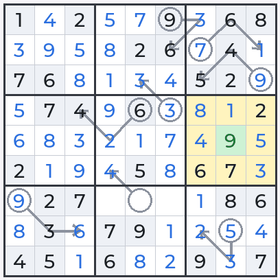

<!-- Written by tools/walkthrough.py arrow: edit the script, not this page. -->
# Arrow, step 46: the 9 in box 6

**Step 46 of 49** · [← Step 45](step-45.md) · [All steps](../arrow.md#the-whole-puzzle-step-by-step) · [Step 47 →](step-47.md)

Box 6 needs a 9, and r5c8 is its last empty cell: **r5c8 = 9**.

**Step 46 of 49** · [← Step 45](step-45.md) · [All steps](../arrow.md#the-whole-puzzle-step-by-step) · [Step 47 →](step-47.md)
