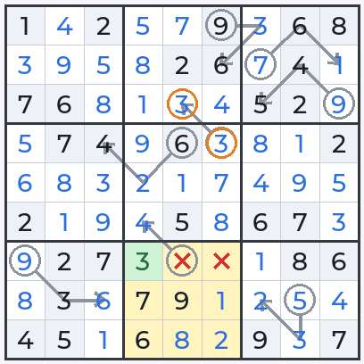

<!-- Written by tools/walkthrough.py arrow: edit the script, not this page. -->
# Arrow, step 47: the 3 in box 8

**Step 47 of 49** · [← Step 46](step-46.md) · [All steps](../arrow.md#the-whole-puzzle-step-by-step) · [Step 48 →](step-48.md)

Box 8 needs a 3. r7c5: column 5 has one (r3c5). r7c6: column 6 has one (r4c6). Only **r7c4** is left: **r7c4 = 3**.

**Step 47 of 49** · [← Step 46](step-46.md) · [All steps](../arrow.md#the-whole-puzzle-step-by-step) · [Step 48 →](step-48.md)
