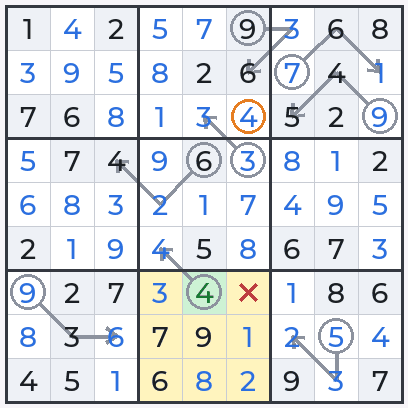

<!-- Written by tools/walkthrough.py arrow: edit the script, not this page. -->
# Arrow, step 48: the 4 in box 8

**Step 48 of 49** · [← Step 47](step-47.md) · [All steps](../arrow.md#the-whole-puzzle-step-by-step) · [Step 49 →](step-49.md)

Box 8 needs a 4. r7c6: column 6 has one (r3c6). Only **r7c5** is left: **r7c5 = 4**.

**Step 48 of 49** · [← Step 47](step-47.md) · [All steps](../arrow.md#the-whole-puzzle-step-by-step) · [Step 49 →](step-49.md)
