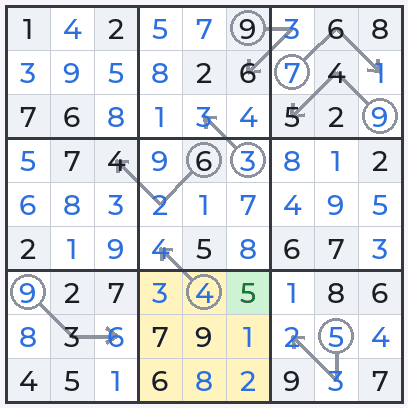

<!-- Written by tools/walkthrough.py arrow: edit the script, not this page. -->
# Arrow, step 49: the 5 in box 8

**Step 49 of 49** · [← Step 48](step-48.md) · [All steps](../arrow.md#the-whole-puzzle-step-by-step) · [All steps](../arrow.md#the-whole-puzzle-step-by-step)

Box 8 needs a 5, and r7c6 is its last empty cell: **r7c6 = 5**.

Solved.

**Step 49 of 49** · [← Step 48](step-48.md) · [All steps](../arrow.md#the-whole-puzzle-step-by-step) · [All steps](../arrow.md#the-whole-puzzle-step-by-step)
