# Asterisk

[← All variants](README.md) · [Puzzles](../features-puzzles.md) · [How to play](../how-to-play.md)

## The rules

[Classic](classic.md) rules, and nine **tinted cells** in an asterisk shape around the centre also hold 1 to 9, each once. The asterisk has one cell in each box: r2c5, r3c3, r3c7, r5c2, r5c5 (the centre), r5c8, r7c3, r7c7 and r8c5.

## On the board

- The nine asterisk cells have a warm tint, like the X-Sudoku diagonals.
- A repeat on the asterisk turns red; hints name it ("Look at the asterisk").
- The rules card draws the whole 9×9 with the asterisk's digits 1 to 9.
- **Puzzles → ⋮ → New puzzle → Asterisk**.

## How to solve it

- The asterisk is one extra "box", spread over all nine boxes: keep track of which of its digits are placed.
- Its cells are far apart, so the rule reaches across the grid: a digit on the asterisk rules out the other eight asterisk cells, in other boxes, other rows and other columns.
- The asterisk often settles the centre cell, r5c5: it sees its row, column, box and the asterisk.
- **Hidden singles on the asterisk:** when a digit can go in only one of its empty cells, it goes there.

## Worked example

**variant-examples #16**, Asterisk Easy (see [Classic](classic.md#worked-example-the-whole-puzzle) for how to import the examples; cells are written r*row*c*column*).

**Step 1: the 4 in column 5.** Column 5 needs a 4; its empty cells are r2c5, r3c5, r5c5, r7c5 and r8c5.

- r2c5: row 2 has a 4 (r2c8).
- r7c5: row 7 has a 4 (r7c3).
- r8c5: box 8 has a 4 (r9c6).
- r5c5: it's the centre of the asterisk, and **r7c3**, also on the asterisk, is a 4. By the Classic rules alone, r5c5 would still be open (row 5, column 5 and box 5 have no 4).

Only **r3c5** is left: **r3c5 = 4**.

**Step 2: the 5 in box 1.** Box 1 (top left) needs a 5. Row 1 has one (r1c4), row 3 too (r3c7), column 1 (r6c1) and column 2 (r8c2): that rules out r1c1, r3c1, r3c3, r2c1 and r2c2. **r2c3 = 5**.

**Step 3: the 9 in box 1.** Row 1 has a 9 (r1c6), row 3 (r3c9) and column 1 (r9c1): r1c1, r3c1, r3c3 and r2c1 are out. **r2c2 = 9**.

Steps 2 and 3 are plain Classic singles: an Easy Asterisk puzzle mixes the two, and the asterisk comes back into play as its cells fill up (r3c3 is on it, and is now one of only two empty cells in box 1).

## The whole puzzle, step by step

<!-- walkthrough -->
<!-- Written by tools/walkthrough.py asterisk: edit the script, not this part. -->

The whole puzzle, from the start to the last cell: 45 steps, each one a single (one place left for a digit, or one digit left for a cell), taken in the order a box's single comes first, so not quite the order of the worked example above. In each picture, the unit the step looks at is tinted yellow (for a cell with one digit left: its row, column and box), the new digit is on green, the digits that rule cells out have an **orange ring**, and the empty cells they rule out a **red cross**. Givens are on grey, digits from earlier steps in blue.

#### Step 1: the 5 in box 1

Box 1 needs a 5. r1c1: row 1 has one (r1c4). r2c1: column 1 has one (r6c1). r2c2: column 2 has one (r8c2). r3c1 and r3c3: row 3 has one (r3c7). Only **r2c3** is left: **r2c3 = 5**.

#### Step 2: the 9 in box 1

Box 1 needs a 9. r1c1: row 1 has one (r1c6). r2c1: column 1 has one (r9c1). r3c1 and r3c3: row 3 has one (r3c9). Only **r2c2** is left: **r2c2 = 9**.

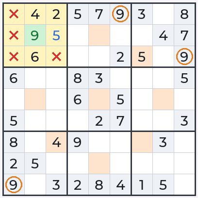

#### Step 3: the 8 in box 1

Box 1 needs an 8. r1c1: row 1 has one (r1c9). r2c1 and r3c1: column 1 has one (r7c1). Only **r3c3** is left: **r3c3 = 8**.

#### Step 4: the 7 in box 1

Box 1 needs a 7. r1c1: row 1 has one (r1c5). r2c1: row 2 has one (r2c9). Only **r3c1** is left: **r3c1 = 7**.

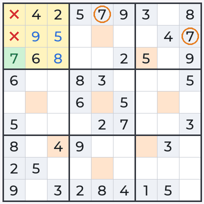

#### Step 5: the 3 in box 1

Box 1 needs a 3. r1c1: row 1 has one (r1c7). Only **r2c1** is left: **r2c1 = 3**.

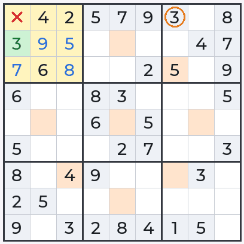

#### Step 6: the 1 in box 1

Box 1 needs a 1, and r1c1 is its last empty cell: **r1c1 = 1**.

#### Step 7: the 3 in box 2

Box 2 needs a 3. r2c4, r2c5 and r2c6: row 2 has one (r2c1). r3c5: column 5 has one (r4c5). Only **r3c4** is left: **r3c4 = 3**.

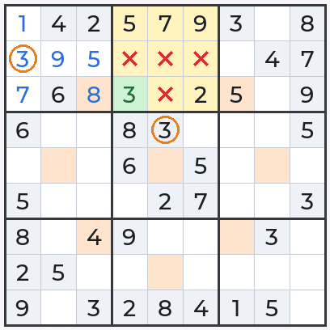

#### Step 8: the 4 in box 2

Box 2 needs a 4. r2c4, r2c5 and r2c6: row 2 has one (r2c8). Only **r3c5** is left: **r3c5 = 4**.

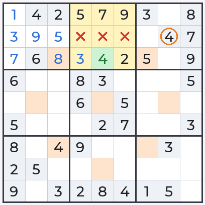

#### Step 9: the 8 in box 2

Box 2 needs an 8. r2c4: column 4 has one (r4c4). r2c5: column 5 has one (r9c5). Only **r2c6** is left: **r2c6 = 8**.

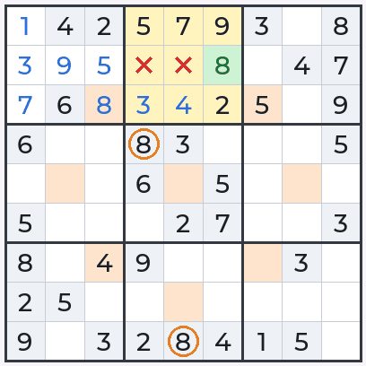

#### Step 10: the 6 in box 2

Box 2 needs a 6. r2c4: column 4 has one (r5c4). Only **r2c5** is left: **r2c5 = 6**.

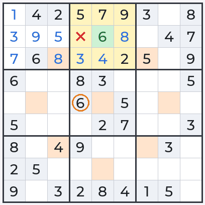

#### Step 11: the 1 in box 2

Box 2 needs a 1, and r2c4 is its last empty cell: **r2c4 = 1**.

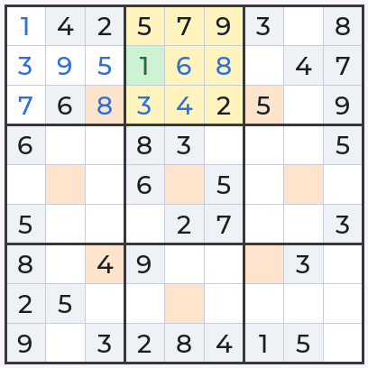

#### Step 12: the 1 in box 3

Box 3 needs a 1. r1c8: row 1 has one (r1c1). r2c7: row 2 has one (r2c4). Only **r3c8** is left: **r3c8 = 1**.

#### Step 13: the 2 in box 3

Box 3 needs a 2. r1c8: row 1 has one (r1c3). Only **r2c7** is left: **r2c7 = 2**.

#### Step 14: the 6 in box 3

Box 3 needs a 6, and r1c8 is its last empty cell: **r1c8 = 6**.

#### Step 15: the 3 in box 4

Box 4 needs a 3. r4c2 and r4c3: row 4 has one (r4c5). r5c1: column 1 has one (r2c1). r5c3: column 3 has one (r9c3). r6c2 and r6c3: row 6 has one (r6c9). Only **r5c2** is left: **r5c2 = 3**.

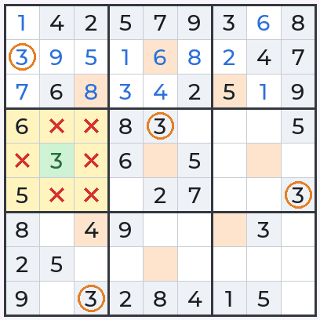

#### Step 16: the 2 in box 4

Box 4 needs a 2. r4c3 and r5c3: column 3 has one (r1c3). r5c1: column 1 has one (r8c1). r6c2 and r6c3: row 6 has one (r6c5). Only **r4c2** is left: **r4c2 = 2**.

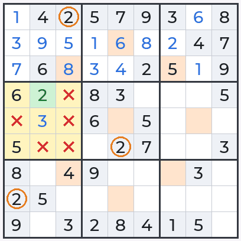

#### Step 17: the 4 in box 4

Box 4 needs a 4. r4c3, r5c3 and r6c3: column 3 has one (r7c3). r6c2: column 2 has one (r1c2). Only **r5c1** is left: **r5c1 = 4**.

#### Step 18: the 8 in box 4

Box 4 needs an 8. r4c3: row 4 has one (r4c4). r5c3 and r6c3: column 3 has one (r3c3). Only **r6c2** is left: **r6c2 = 8**.

#### Step 19: the 4 in box 5

Box 5 needs a 4. r4c6: column 6 has one (r9c6). r5c5: row 5 has one (r5c1). Only **r6c4** is left: **r6c4 = 4**.

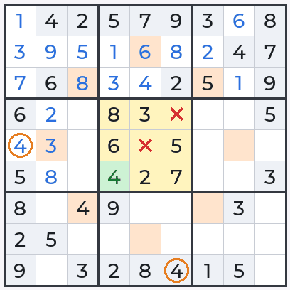

#### Step 20: the 9 in box 5

Box 5 needs a 9. r4c6: column 6 has one (r1c6). Only **r5c5** is left: **r5c5 = 9**.

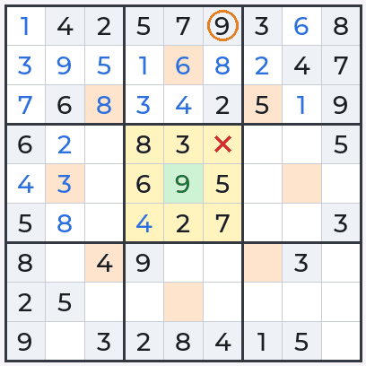

#### Step 21: the 1 in box 5

Box 5 needs a 1, and r4c6 is its last empty cell: **r4c6 = 1**.

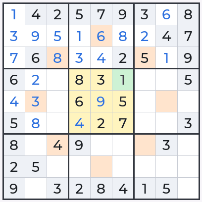

#### Step 22: the 1 in box 6

Box 6 needs a 1. r4c7 and r4c8: row 4 has one (r4c6). r5c7 and r6c7: column 7 has one (r9c7). r5c8 and r6c8: column 8 has one (r3c8). Only **r5c9** is left: **r5c9 = 1**.

#### Step 23: the 1 in box 4

Box 4 needs a 1. r4c3: row 4 has one (r4c6). r5c3: row 5 has one (r5c9). Only **r6c3** is left: **r6c3 = 1**.

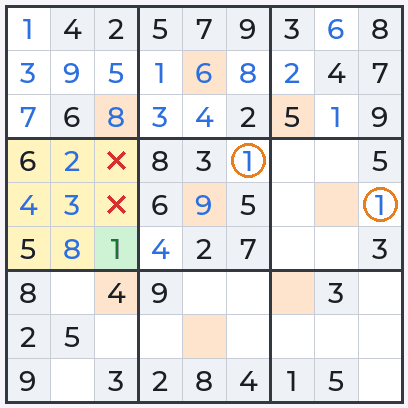

#### Step 24: the 9 in box 4

Box 4 needs a 9. r5c3: row 5 has one (r5c5). Only **r4c3** is left: **r4c3 = 9**.

#### Step 25: the 7 in box 4

Box 4 needs a 7, and r5c3 is its last empty cell: **r5c3 = 7**.

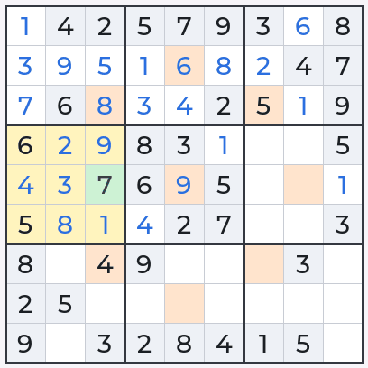

#### Step 26: the 2 in box 6

Box 6 needs a 2. r4c7 and r4c8: row 4 has one (r4c2). r5c7: column 7 has one (r2c7). r6c7 and r6c8: row 6 has one (r6c5). Only **r5c8** is left: **r5c8 = 2**.

#### Step 27: the 4 in box 6

Box 6 needs a 4. r4c8: column 8 has one (r2c8). r5c7: row 5 has one (r5c1). r6c7 and r6c8: row 6 has one (r6c4). Only **r4c7** is left: **r4c7 = 4**.

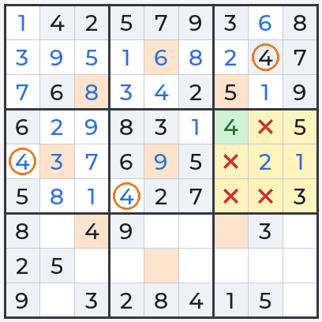

#### Step 28: the 6 in box 6

Box 6 needs a 6. r4c8: row 4 has one (r4c1). r5c7: row 5 has one (r5c4). r6c8: column 8 has one (r1c8). Only **r6c7** is left: **r6c7 = 6**.

#### Step 29: the 7 in box 6

Box 6 needs a 7. r5c7: row 5 has one (r5c3). r6c8: row 6 has one (r6c6). Only **r4c8** is left: **r4c8 = 7**.

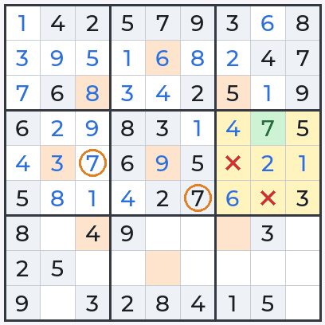

#### Step 30: the 8 in box 6

Box 6 needs an 8. r6c8: row 6 has one (r6c2). Only **r5c7** is left: **r5c7 = 8**.

#### Step 31: the 9 in box 6

Box 6 needs a 9, and r6c8 is its last empty cell: **r6c8 = 9**.

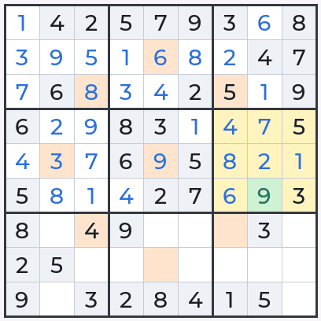

#### Step 32: the 1 in box 7

Box 7 needs a 1. r8c3: column 3 has one (r6c3). r9c2: row 9 has one (r9c7). Only **r7c2** is left: **r7c2 = 1**.

#### Step 33: the 6 in box 7

Box 7 needs a 6. r9c2: column 2 has one (r3c2). Only **r8c3** is left: **r8c3 = 6**.

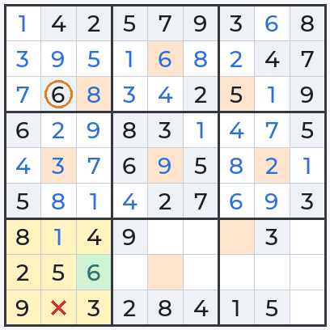

#### Step 34: the 7 in box 7

Box 7 needs a 7, and r9c2 is its last empty cell: **r9c2 = 7**.

#### Step 35: the 1 in box 8

Box 8 needs a 1. r7c5 and r7c6: row 7 has one (r7c2). r8c4: column 4 has one (r2c4). r8c6: column 6 has one (r4c6). Only **r8c5** is left: **r8c5 = 1**.

#### Step 36: the 3 in box 8

Box 8 needs a 3. r7c5 and r7c6: row 7 has one (r7c8). r8c4: column 4 has one (r3c4). Only **r8c6** is left: **r8c6 = 3**.

#### Step 37: the 5 in box 8

Box 8 needs a 5. r7c6: column 6 has one (r5c6). r8c4: row 8 has one (r8c2). Only **r7c5** is left: **r7c5 = 5**.

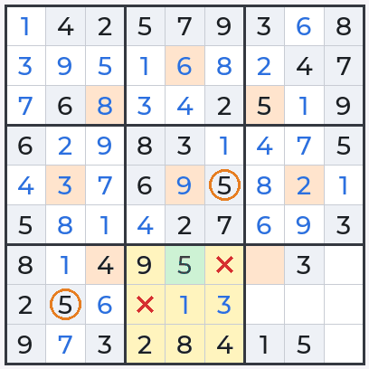

#### Step 38: the 6 in box 8

Box 8 needs a 6. r8c4: row 8 has one (r8c3). Only **r7c6** is left: **r7c6 = 6**.

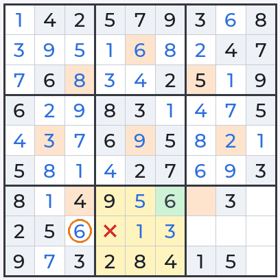

#### Step 39: the 7 in box 8

Box 8 needs a 7, and r8c4 is its last empty cell: **r8c4 = 7**.

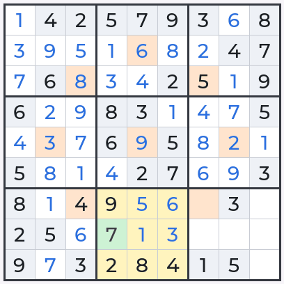

#### Step 40: the 2 in box 9

Box 9 needs a 2. r7c7: column 7 has one (r2c7). r8c7, r8c8 and r8c9: row 8 has one (r8c1). r9c9: row 9 has one (r9c4). Only **r7c9** is left: **r7c9 = 2**.

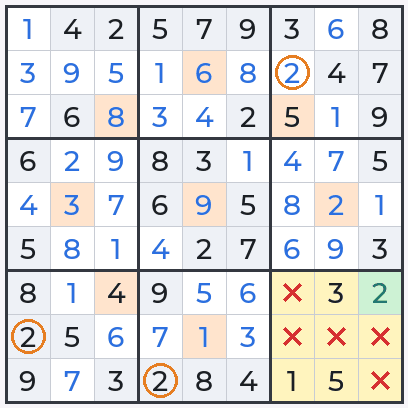

#### Step 41: the 4 in box 9

Box 9 needs a 4. r7c7: row 7 has one (r7c3). r8c7: column 7 has one (r4c7). r8c8: column 8 has one (r2c8). r9c9: row 9 has one (r9c6). Only **r8c9** is left: **r8c9 = 4**.

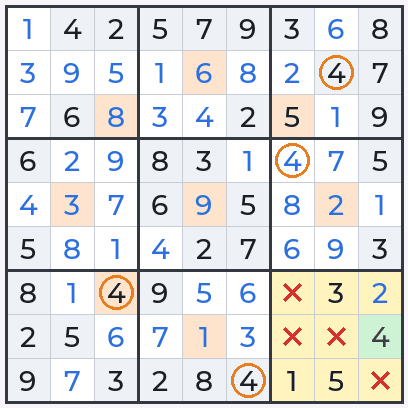

#### Step 42: the 6 in box 9

Box 9 needs a 6. r7c7: row 7 has one (r7c6). r8c7 and r8c8: row 8 has one (r8c3). Only **r9c9** is left: **r9c9 = 6**.

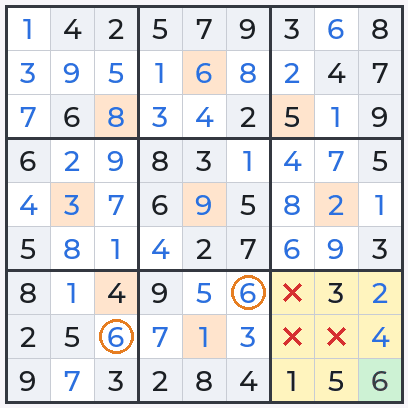

#### Step 43: the 7 in box 9

Box 9 needs a 7. r8c7 and r8c8: row 8 has one (r8c4). Only **r7c7** is left: **r7c7 = 7**.

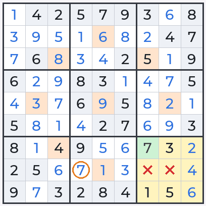

#### Step 44: the 8 in box 9

Box 9 needs an 8. r8c7: column 7 has one (r5c7). Only **r8c8** is left: **r8c8 = 8**.

#### Step 45: the 9 in box 9

Box 9 needs a 9, and r8c7 is its last empty cell: **r8c7 = 9**.

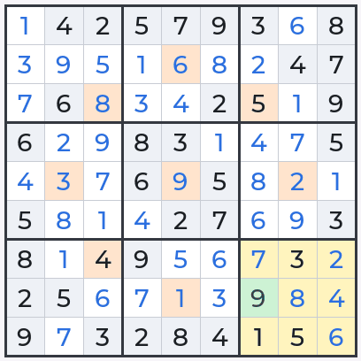

Solved.

<!-- /walkthrough -->
