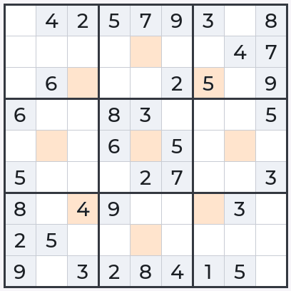

# Asterisk

[← All variants](README.md) · [Puzzles](../features-puzzles.md) · [How to play](../how-to-play.md)

## The rules

[Classic](classic.md) rules, and nine **tinted cells** in an asterisk shape around the centre also hold 1 to 9, each once. The asterisk has one cell in each box: r2c5, r3c3, r3c7, r5c2, r5c5 (the centre), r5c8, r7c3, r7c7 and r8c5.

## On the board

- The nine asterisk cells have a warm tint, like the X-Sudoku diagonals.
- A repeat on the asterisk turns red; hints name it ("Look at the asterisk").
- The rules card draws the whole 9×9 with the asterisk's digits 1 to 9.
- **Puzzles → ⋮ → New puzzle → Asterisk**.

## How to solve it

- The asterisk is one extra "box", spread over all nine boxes: keep track of which of its digits are placed.
- Its cells are far apart, so the rule reaches across the grid: a digit on the asterisk rules out the other eight asterisk cells, in other boxes, other rows and other columns.
- The asterisk often settles the centre cell, r5c5: it sees its row, column, box and the asterisk.
- **Hidden singles on the asterisk:** when a digit can go in only one of its empty cells, it goes there.

## Worked example

**variant-examples #16**, Asterisk Easy (see [Classic](classic.md#worked-example-the-whole-puzzle) for how to import the examples; cells are written r*row*c*column*).

**Step 1: the 4 in column 5.** Column 5 needs a 4; its empty cells are r2c5, r3c5, r5c5, r7c5 and r8c5.

- r2c5: row 2 has a 4 (r2c8).
- r7c5: row 7 has a 4 (r7c3).
- r8c5: box 8 has a 4 (r9c6).
- r5c5: it's the centre of the asterisk, and **r7c3**, also on the asterisk, is a 4. By the Classic rules alone, r5c5 would still be open (row 5, column 5 and box 5 have no 4).

Only **r3c5** is left: **r3c5 = 4**.

**Step 2: the 5 in box 1.** Box 1 (top left) needs a 5. Row 1 has one (r1c4), row 3 too (r3c7), column 1 (r6c1) and column 2 (r8c2): that rules out r1c1, r3c1, r3c3, r2c1 and r2c2. **r2c3 = 5**.

**Step 3: the 9 in box 1.** Row 1 has a 9 (r1c6), row 3 (r3c9) and column 1 (r9c1): r1c1, r3c1, r3c3 and r2c1 are out. **r2c2 = 9**.

Steps 2 and 3 are plain Classic singles: an Easy Asterisk puzzle mixes the two, and the asterisk comes back into play as its cells fill up (r3c3 is on it, and is now one of only two empty cells in box 1).

## The whole puzzle, step by step

<!-- walkthrough -->
<!-- Written by tools/walkthrough.py asterisk: edit the script, not this part. -->

The whole puzzle, from the start to the last cell: 45 steps, each one a single (one place left for a digit, or one digit left for a cell), taken in the order a box's single comes first, so not quite the order of the worked example above. Each step has a page of its own, with **Previous** and **Next**: pick its number below. In each picture, the unit the step looks at is tinted yellow (for a cell with one digit left: its row, column and box), the new digit is on green, the digits that rule cells out have an **orange ring**, and the empty cells they rule out a **red cross**. Givens are on grey, digits from earlier steps in blue.

| [1](asterisk/step-01.md) | [2](asterisk/step-02.md) | [3](asterisk/step-03.md) | [4](asterisk/step-04.md) | [5](asterisk/step-05.md) | [6](asterisk/step-06.md) | [7](asterisk/step-07.md) | [8](asterisk/step-08.md) | [9](asterisk/step-09.md) | [10](asterisk/step-10.md) |
|:-:|:-:|:-:|:-:|:-:|:-:|:-:|:-:|:-:|:-:|
| [11](asterisk/step-11.md) | [12](asterisk/step-12.md) | [13](asterisk/step-13.md) | [14](asterisk/step-14.md) | [15](asterisk/step-15.md) | [16](asterisk/step-16.md) | [17](asterisk/step-17.md) | [18](asterisk/step-18.md) | [19](asterisk/step-19.md) | [20](asterisk/step-20.md) |
| [21](asterisk/step-21.md) | [22](asterisk/step-22.md) | [23](asterisk/step-23.md) | [24](asterisk/step-24.md) | [25](asterisk/step-25.md) | [26](asterisk/step-26.md) | [27](asterisk/step-27.md) | [28](asterisk/step-28.md) | [29](asterisk/step-29.md) | [30](asterisk/step-30.md) |
| [31](asterisk/step-31.md) | [32](asterisk/step-32.md) | [33](asterisk/step-33.md) | [34](asterisk/step-34.md) | [35](asterisk/step-35.md) | [36](asterisk/step-36.md) | [37](asterisk/step-37.md) | [38](asterisk/step-38.md) | [39](asterisk/step-39.md) | [40](asterisk/step-40.md) |
| [41](asterisk/step-41.md) | [42](asterisk/step-42.md) | [43](asterisk/step-43.md) | [44](asterisk/step-44.md) | [45](asterisk/step-45.md) |  |  |  |  |  |

Solved.

<!-- /walkthrough -->
