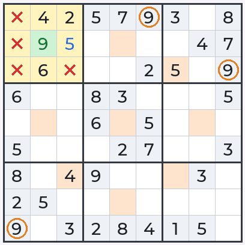

<!-- Written by tools/walkthrough.py asterisk: edit the script, not this page. -->
# Asterisk, step 2: the 9 in box 1

**Step 2 of 45** · [← Step 1](step-01.md) · [All steps](../asterisk.md#the-whole-puzzle-step-by-step) · [Step 3 →](step-03.md)

Box 1 needs a 9. r1c1: row 1 has one (r1c6). r2c1: column 1 has one (r9c1). r3c1 and r3c3: row 3 has one (r3c9). Only **r2c2** is left: **r2c2 = 9**.

**Step 2 of 45** · [← Step 1](step-01.md) · [All steps](../asterisk.md#the-whole-puzzle-step-by-step) · [Step 3 →](step-03.md)
