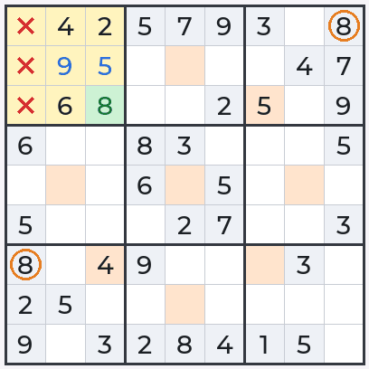

<!-- Written by tools/walkthrough.py asterisk: edit the script, not this page. -->
# Asterisk, step 3: the 8 in box 1

**Step 3 of 45** · [← Step 2](step-02.md) · [All steps](../asterisk.md#the-whole-puzzle-step-by-step) · [Step 4 →](step-04.md)

Box 1 needs an 8. r1c1: row 1 has one (r1c9). r2c1 and r3c1: column 1 has one (r7c1). Only **r3c3** is left: **r3c3 = 8**.

**Step 3 of 45** · [← Step 2](step-02.md) · [All steps](../asterisk.md#the-whole-puzzle-step-by-step) · [Step 4 →](step-04.md)
